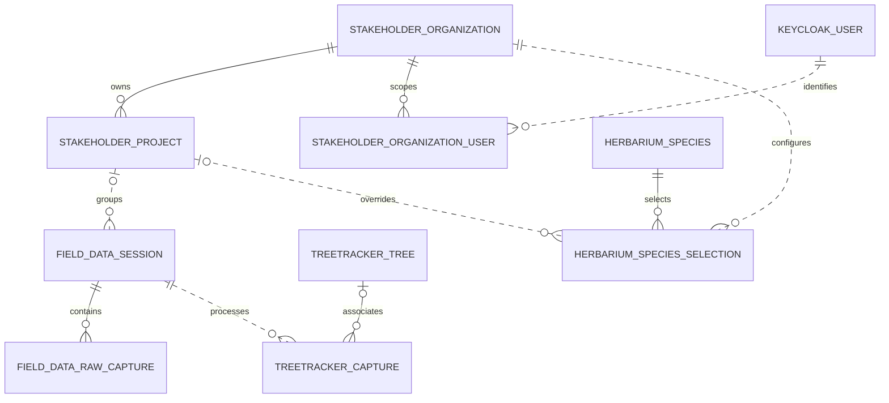
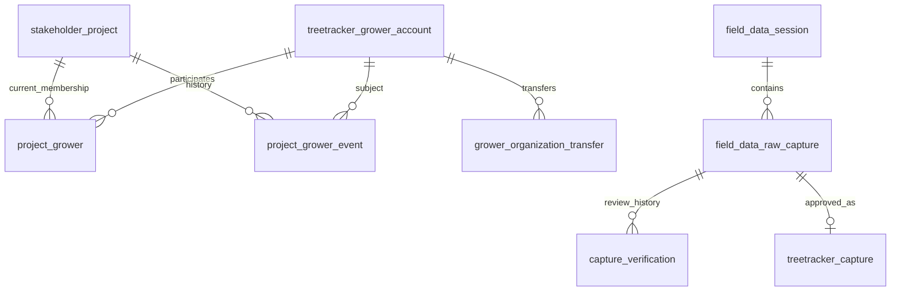
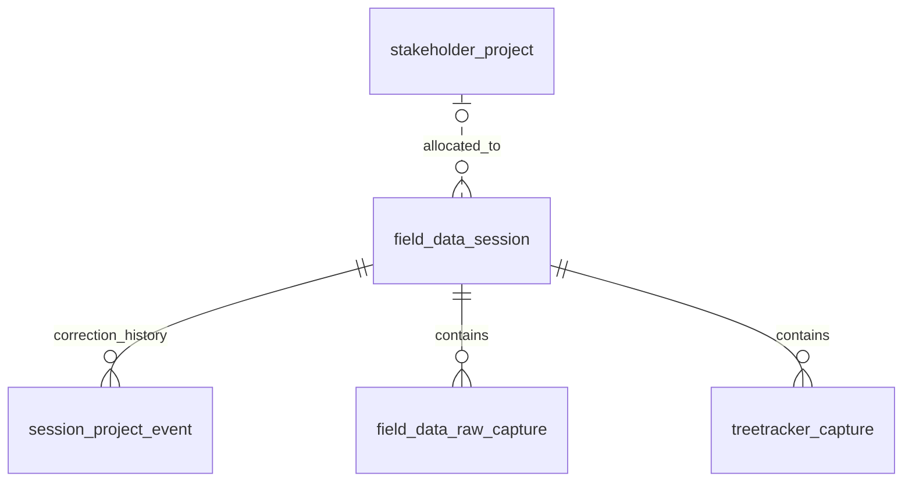

# Domain administration API

The /api/admin-domain routes support organization-scoped views over the new domain model. They use the existing Keycloak bearer middleware and a bounded PostgreSQL pool. The admin API is the administration facade for these views. This implementation performs parameterized domain reads and writes in the admin API; review write ownership alongside the domain service migrations before deployment.

## Domain ownership

| Capability | Tables or source |
| --- | --- |
| Organizations and projects | stakeholder.stakeholder, stakeholder.project |
| Scoped user permissions | stakeholder.organization_user |
| Tracking and capture review | field_data.session, session_segment, raw_capture |
| Dashboard | treetracker.grower_account and treetracker.capture |
| Contracts and documents | contracts.agreement, contract, contract_document, document |
| Species | herbarium.species, species_selection, common_name |
| SaaS accounts and billing | Keycloak role members and Stripe metadata |

The API resolves numeric Keycloak organization_id claims to exactly one active Stakeholder UUID. Caller-supplied organization filters cannot override membership. Platform administration requires greenstand-admin. The org-admin-saas role receives organization administrator capabilities. Other org members default to verify_captures, with additional scoped grants in stakeholder.organization_user.

Project and species-selection writes enforce their capabilities. User-permission writes require manage_members, verify the target's approved Keycloak membership, preserve administrator capabilities, and reject stale edits. This directory manages existing approved members. Invitation and organization binding use their existing workflows. Integrating these grants with legacy verification operations is separate migration work.

## Routes

| Suffix after /api/admin-domain | Methods | Purpose |
| --- | --- | --- |
| /context | GET | Resolved organization and capabilities |
| /dashboard | GET | Counts and recent captures |
| /organizations | GET, POST | Stakeholder organization directory |
| /organizations/:id | PATCH | Edit an organization |
| /projects | GET, POST | Search and create projects |
| /projects/:id | PATCH | Versioned project edits |
| /sessions | GET | Session counts, review and segment area |
| /sessions/:id/captures | GET | Session captures, capped at 1,000 |
| /contracts | GET | Agreements and workers |
| /contracts/:id/documents | GET | Authorized documents |
| /species | GET, POST | Catalog search and creation |
| /species/:id | PATCH | Versioned catalog edits |
| /species-selection | GET, PUT | Scoped selection and inheritance |
| /organization-users | GET | Approved organization directory |
| /organization-users/:id | PUT | Scoped permission grants |
| /saas/users | GET | Platform subscription overview |
| /subscription-plans | GET | Existing tiers and allowance proposal |

Lists return rows and hasNext and accept page and size, with sizes 25, 50 or 100. Search and sort fields are allowlisted. Organization filters are UUIDs. Timestamp versions retain database microsecond precision. Species-selection replacement is transactional and serialized per scope.

An empty project selection inherits organization selections. An empty organization selection inherits visible default species. Hiding species retains historical references. Project media uses URLs; binary upload storage is separate integration work.

## Existing Stripe tiers

These prices and tiers already exist in Stripe. This API describes their application allowances.

| Plan | USD/month | Seats | Total captures | Growers | Projects | Wallet |
| --- | --- | --- | --- | --- | --- | --- |
| Seed | 9 | 1 | 5,000 | 10 | 1 | No |
| Root | 29 | 3 | 50,000 | 100 | 5 | No |
| Base | 69 | 10 | 250,000 | 1,000 | 20 | Yes |
| Crown | 150 | 25 | 1,000,000 | 5,000 | 100 | Yes |

Prices, Seed allowances and Crown's capture allowance are confirmed. Other allowances and wallet availability are proposed. The capture basis is total managed inventory, confirmed by the user. Quota and wallet enforcement depend on agreement of the proposal and the organization subscription authorization work in admin-client #1261 and #1216.

## Deployment

Apply Stakeholder project and organization-user migrations from PR #49, Field Data session-project assignment from PR #121, and Herbarium scoped-selection and catalog-setting migrations from PR #10 first. Migration owners and the existing migration histories remain the deployment mechanism.

Configure DATABASE_URL, verified TLS through PGSSLROOTCERT where required, the Keycloak issuer and realm, and the expected frontend client. The API database role needs these domain reads and administrative writes.

User directories require KEYCLOAK_ADMIN_ID and KEYCLOAK_ADMIN_CLIENT_SECRET with user and role-membership read permission. SaaS billing requires STRIPE_SECRET_KEY with subscription and price read permission. Runtime prices, currency and billing intervals come from Stripe. The price amounts shown in the proposal below document the existing tiers; they are not entitlement rules. STRIPE_PRICE_SEED, STRIPE_PRICE_ROOT, STRIPE_PRICE_BASE and STRIPE_PRICE_CROWN can select the Stripe Price IDs for the catalog. Missing or failed Stripe access is labelled Billing unavailable; a confirmed empty result is No subscription. Stripe metadata search has indexing delay. Checkout confirmation belongs to the existing Checkout Session flow in API PR #680.

The local development secrets are held outside the tracked upstream environment file. Live Keycloak directory and Stripe lookup validation remain pending those credentials.

## Relationships

Cross-schema and external identity references are checked by the API. Dev validation uses the known dev cluster and synthetic QA records. Production migration and deployment remain pending.

## Hosted subscription actions

GET /billing returns the selected organization's actual Stripe subscription status. POST /billing/session accepts an approved organization scope, a configured tier name and a UUID requestId. Organization administrators and platform administrators can open this flow.

A first subscription opens Stripe Checkout with server-resolved organization metadata. An existing subscription opens the customer portal confirmation flow for the selected price. A pending checkout is reused for the same tier. Conflicting pending flows or multiple customers/subscriptions require reconciliation. The API serializes billing operations per organization and uses Stripe idempotency keys. Payment and plan-change confirmation take place on Stripe.

Configure STRIPE_RETURN_URL to the trusted panel subscription page. The key needs Customer read/write, Subscription read, Price read, Checkout Session read/write, and Billing Portal Session write. Configure the existing Stripe portal to permit the current tier products and prices. These operational settings have been deferred at the user's request. Live payment actions have not been exercised.

A manually assigned subscriber_seed role is a Keycloak marker. The billing UI derives paid status from Stripe. The existing PHP webhook reconciles roles after actual subscription changes.

The sanitized PHP provisioning prototype is versioned at examples/stripe-keycloak-webhook.php. It is deployed separately on the existing PHP host. Supply secrets through its environment or private host configuration. It is a reference for the existing webhook behavior and is independent of the Node API runtime.

## Species names and empty selections

Organization-local names reuse herbarium.common_name and herbarium.organization_species. The global catalog excludes organization-linked name records; /species-selection returns a scoped localNames library. PUT accepts localNames as species_id/name entries and keeps one selected local_name per species and scope. Names are saved transactionally and cannot cross organization boundaries.

The Herbarium migration 20261122090000-species-selection-options adds species_selection_scope so an explicitly empty custom list remains empty. New callers send inherit:false for custom lists, including empty ones; inherit:true restores the parent/default list. Older empty-array callers retain their previous inheritance behavior. No legacy public schema is extended.

~~~mermaid
erDiagram
    HERBARIUM_SPECIES ||--o{ HERBARIUM_COMMON_NAME : names
    HERBARIUM_COMMON_NAME ||--o{ HERBARIUM_ORGANIZATION_SPECIES : scopes
    STAKEHOLDER_ORGANIZATION ||..o{ HERBARIUM_ORGANIZATION_SPECIES : owns
    STAKEHOLDER_ORGANIZATION ||..o{ HERBARIUM_SPECIES_SELECTION_SCOPE : configures
    STAKEHOLDER_PROJECT |o..o{ HERBARIUM_SPECIES_SELECTION_SCOPE : overrides
    HERBARIUM_SPECIES ||--o{ HERBARIUM_SPECIES_SELECTION : selects
~~~

New projects created through this API atomically receive an empty project species scope. Species start unselected until explicitly allocated. Editing existing projects does not change their selections. Users can explicitly restore organization/default inheritance.

## On-demand session map preview

GET /api/admin-domain/sessions/:id/map checks the same organization ownership boundary as capture details. It returns only an approximate outer convex envelope as GeoJSON, using field_data.session_segment geometry first and valid raw_capture / treetracker.capture coordinates as fallback. Capture records and photos are not transferred. Point / line geometries are supported when too few distinct locations exist. Missing geometry returns null. This endpoint is read-only and adds no database fields.

GET /api/admin-domain/growers/:id reads treetracker.grower_account with organization authorization, projects from stakeholder.project_grower or explicitly organization-linked session activity, and last-uploaded app version from field_data.device_configuration. Project results distinguish assignment from observed session activity, include ended assignments, and are capped at 100. No project memberships are inferred solely from organization membership. Unauthorized accounts return 404 before project/device queries.

## Growers list migration

GET /api/admin-domain/growers replaces the local panel's legacy planter list with treetracker.grower_account reads. Organization boundaries include the account's organization, active stakeholder.project_grower assignments and explicitly scoped field_data.session activity. Server-side search, whitelisted sorts and pagination are supported. Capture metrics combine linked raw verification states and active processed captures without double-counting capture IDs; unavailable review state is explicit. GET /sessions supports a UUID growerId filter for account session history. No public.planter/entity tables or schema extensions are used.

## NDM verification and grower membership audit

`GET /verification` reads `field_data.raw_capture` in its session's resolved Stakeholder organization. `POST /verification` checks `verify_captures`, locks the batch, checks exact capture versions, and records the authenticated reviewer in `field_data.capture_verification`. Approval creates `treetracker.capture` plus NDM tags and a raised `CaptureCreated` domain event. Rejection requires a reason. Requests are idempotent and a conflict rolls back the whole batch. No legacy tree writes occur.

**Matching limitation:** the local integration records a raised event but does not publish it to the capture-created queue. Deployment still requires an outbox publisher/service integration. Approval alone does not set `tree_id` or create a tree.

`GET /sessions?sessionId=<UUID>` returns exact, organization-scoped session statistics for the verification sidebar. Counts cover the entire session, independent of the queue's page and status filter; captures present in both raw and processed tables are counted once. Missing review status is reported separately. Capture span is the first-to-last capture interval; area comes from session segment geometry.

`GET /projects/:id/growers` lists current/former project members and eligible organization growers. `POST /projects/:id/growers/:growerId` accepts `action` (`assign`/`remove`), `joined_at` (exact version or null for never assigned), `reason`, and `requestId`. Requires `manage_projects`; organization membership must be primary or an active `grower_account_org` link. A session-only association is insufficient. New assignments require an active project. Removing a grower sets `left_at`; reassignment starts a new membership interval. It never changes historical session/capture ownership or other project memberships.

`GET /projects/:id/grower-history` pages the append-only application trail: actor UUID/name, timestamp, action, reason, previous membership dates, and source. Original memberships have no invented historical actor. The `stakeholder.project_grower_event` migration is required before enabling writes.

Platform-only `POST /growers/:id/organization` changes current primary organization, maintains NDM organization links, closes active project memberships in the old primary organization, and writes both `treetracker.grower_organization_transfer` and per-project removal events. The real authenticated actor and mandatory reason are retained. Historical sessions, captures, contracts, payments, Keycloak users and Stripe associations are unchanged. Both membership operations lock the grower before membership rows so transfers and assignments serialize.

Required schema migrations: Field Data `20261122100000-capture-verification-audit`, Treetracker `20261122110000-grower-organization-transfer-audit`, Stakeholder `20261122120000-project-grower-audit`. Applied and exercised with disposable fixtures in dev; no production migration has been run.

Keycloak directory access uses server-only service-account credentials; human `greenstand-admin` grants app access but does not automatically grant the backend Keycloak Admin API permissions. Directory failures return an explicit service error, not an empty user list.

## Session project allocation corrections

`GET /sessions/:id/project` returns the session's actual NDM project allocation, latest allocation-event UUID and paged correction history (`page`, `size`). `POST` on the same URL accepts nullable `project_id`, `expected_project_id`, `expected_event_id`, a required `reason` and `requestId`. Requires `manage_projects` in the session organization. Assign/reassign accepts only active projects in that organization; null clears the allocation. The session is locked, current allocation and event version checked, and the update/audit insert committed atomically. Retries with the same request replay safely; a stale change—including a project changed away and back—is rejected.

The existing `field_data.session.project_id` is the canonical allocation for the entire session. Capture project reporting derives from its session. These corrections do not change grower project enrollment, capture review status or tree associations. The first correction stores the previous app/initial value; the initial actor is not fabricated. `field_data.session_project_event` stores previous/new project UUID, actor UUID/name, time, reason, organization and request hash. Apply migration `20261122130000-session-project-audit` before enabling these routes, plus session project column migration in Field Data #121.

**App integration gap:** the current Field Data `sessionPostSchema` rejects unknown fields and does not accept `project_id`; `SessionModel` also omits it from responses. Automatic app allocation needs an explicit selected project in the upload contract and validation against the session organization. A grower may have multiple projects, so enrollment alone cannot determine the session project. Upload retries must preserve existing admin corrections. The admin correction feature is implemented independently of that mobile/ingestion work.

NDM verification does not offer legacy leaf/tree classification categories or remembered form choices. New submissions send only explicitly entered optional text tags; no classification tag is added automatically. The form resets after successful review.

## Batched verification and scoped capture-tag dictionary

`GET /capture-tags` requires a resolved organization and verification permission. There is no all-organization dictionary for platform callers. Active `treetracker.tag` rows owned by the Stakeholder UUID are offered; a legacy unowned public name is offered only with proven usage on that organization's active NDM captures. Another organization's tag is never offered, even if marked public. Optional `projectId` must belong to the organization and narrows results to usage on the project's session captures. Names are searched and reused case-insensitively. New tags are organization-owned/private. `treetracker.capture_tag` remains the link table; project usage follows `capture.session_id → session.project_id`.

Verification locks/version-checks the entire selected batch, checks processed IDs/references once, bulk-inserts approved captures, resolves tag names once per organization, bulk-links tags, writes matching events and review audits in bulk, and updates raw status in one statement. Timestamp values are preserved in SQL. It retains all-or-nothing rollback, real reviewer IDs and payload-hash replay protection. No legacy public/tag/tree writes and no automatic matching publication.

Measured in dev on disposable fixtures (25 captures, two tags): 258 transaction statements / 74.49 seconds before; 13 / 4.12 seconds after. New lookup indexes are in Treetracker migration `20261122140000-scoped-capture-tag-lookups`. Ownership already exists in `tag.owner_id`; no new ownership columns are needed. Scoped API and writer enforce ownership. Legacy `/tags` reads `public.tag`; remaining legacy callers require separate migration to this scoped endpoint before they can meet these visibility rules. No blanket copying of unowned global names.

## Subscription resource usage

`GET /subscription-usage` requires an active, resolved organization, including for platform administrators. It returns numeric `projects`, `captures`, `growers`, `organizationId`, and `asOf`. It is read-only and independent of Stripe availability; no migration or new quota fields are required.

- Projects: all organization projects, including archived projects.
- Captures: total managed raw captures in organization sessions plus active NDM captures owned by the organization; UUID union counts raw/approved copies once. Pending and rejected captures are included. This is not a monthly upload counter.
- Growers: unique existing grower accounts visible through primary organization ownership, current project enrollment, or organization-session wallet registration, matching the Growers list.

Subscription plans combine these counts with the current Stripe-resolved tier and the configured plan catalog. Usage strictly above a limit is over quota; exactly at it is at quota. Unknown subscription/failed usage reads do not invent zero values or enforce an unknown quota. This adds usage presentation and upgrade guidance; server-side quota enforcement remains separate work.

Dev disposable fixtures verified pending/rejected capture accounting, deduplication after approval, archived project counts, grower-link deduplication, and organization boundaries. No Stripe subscription was changed by the tests.
