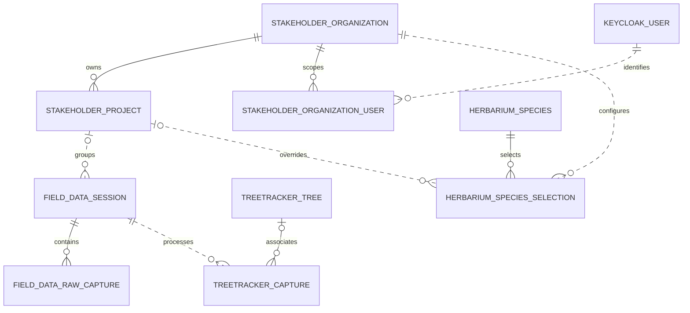

# Domain administration API

The /api/admin-domain routes support organization-scoped views over the new domain model. They use the existing Keycloak bearer middleware and a bounded PostgreSQL pool. The admin API is the administration facade for these views. This implementation performs parameterized domain reads and writes in the admin API; review write ownership alongside the domain service migrations before deployment.

## Domain ownership

| Capability | Tables or source |
| --- | --- |
| Organizations and projects | stakeholder.stakeholder, stakeholder.project |
| Scoped user permissions | stakeholder.organization_user |
| Tracking and capture review | field_data.session, session_segment, raw_capture |
| Dashboard | treetracker.grower_account and treetracker.capture |
| Contracts and documents | contracts.agreement, contract, contract_document, document |
| Species | herbarium.species, species_selection, common_name |
| SaaS accounts and billing | Keycloak role members and Stripe metadata |

The API resolves numeric Keycloak organization_id claims to exactly one active Stakeholder UUID. Caller-supplied organization filters cannot override membership. Platform administration requires greenstand-admin. The org-admin-saas role receives organization administrator capabilities. Other org members default to verify_captures, with additional scoped grants in stakeholder.organization_user.

Project and species-selection writes enforce their capabilities. User-permission writes require manage_members, verify the target's approved Keycloak membership, preserve administrator capabilities, and reject stale edits. This directory manages existing approved members. Invitation and organization binding use their existing workflows. Integrating these grants with legacy verification operations is separate migration work.

## Routes

| Suffix after /api/admin-domain | Methods | Purpose |
| --- | --- | --- |
| /context | GET | Resolved organization and capabilities |
| /dashboard | GET | Counts and recent captures |
| /organizations | GET, POST | Stakeholder organization directory |
| /organizations/:id | PATCH | Edit an organization |
| /projects | GET, POST | Search and create projects |
| /projects/:id | PATCH | Versioned project edits |
| /sessions | GET | Session counts, review and segment area |
| /sessions/:id/captures | GET | Session captures, capped at 1,000 |
| /contracts | GET | Agreements and workers |
| /contracts/:id/documents | GET | Authorized documents |
| /species | GET, POST | Catalog search and creation |
| /species/:id | PATCH | Versioned catalog edits |
| /species-selection | GET, PUT | Scoped selection and inheritance |
| /organization-users | GET | Approved organization directory |
| /organization-users/:id | PUT | Scoped permission grants |
| /saas/users | GET | Platform subscription overview |
| /subscription-plans | GET | Existing tiers and allowance proposal |

Lists return rows and hasNext and accept page and size, with sizes 25, 50 or 100. Search and sort fields are allowlisted. Organization filters are UUIDs. Timestamp versions retain database microsecond precision. Species-selection replacement is transactional and serialized per scope.

An empty project selection inherits organization selections. An empty organization selection inherits visible default species. Hiding species retains historical references. Project media uses URLs; binary upload storage is separate integration work.

## Existing Stripe tiers

These prices and tiers already exist in Stripe. This API describes their application allowances.

| Plan | USD/month | Seats | Total captures | Growers | Projects | Wallet |
| --- | --- | --- | --- | --- | --- | --- |
| Seed | 9 | 1 | 5,000 | 10 | 1 | No |
| Root | 29 | 3 | 50,000 | 100 | 5 | No |
| Base | 69 | 10 | 250,000 | 1,000 | 20 | Yes |
| Crown | 150 | 25 | 1,000,000 | 5,000 | 100 | Yes |

Prices, Seed allowances and Crown's capture allowance are confirmed. Other allowances and wallet availability are proposed. The capture basis is total managed inventory, confirmed by the user. Quota and wallet enforcement depend on agreement of the proposal and the organization subscription authorization work in admin-client #1261 and #1216.

## Deployment

Apply Stakeholder project and organization-user migrations from PR #49, Field Data session-project assignment from PR #121, and Herbarium scoped-selection and catalog-setting migrations from PR #10 first. Migration owners and the existing migration histories remain the deployment mechanism.

Configure DATABASE_URL, verified TLS through PGSSLROOTCERT where required, the Keycloak issuer and realm, and the expected frontend client. The API database role needs these domain reads and administrative writes.

User directories require KEYCLOAK_ADMIN_ID and KEYCLOAK_ADMIN_CLIENT_SECRET with user and role-membership read permission. SaaS billing requires STRIPE_SECRET_KEY with subscription and price read permission. Runtime prices, currency and billing intervals come from Stripe. The price amounts shown in the proposal below document the existing tiers; they are not entitlement rules. STRIPE_PRICE_SEED, STRIPE_PRICE_ROOT, STRIPE_PRICE_BASE and STRIPE_PRICE_CROWN can select the Stripe Price IDs for the catalog. Missing or failed Stripe access is labelled Billing unavailable; a confirmed empty result is No subscription. Stripe metadata search has indexing delay. Checkout confirmation belongs to the existing Checkout Session flow in API PR #680.

The local development secrets are held outside the tracked upstream environment file. Live Keycloak directory and Stripe lookup validation remain pending those credentials.

## Relationships

Cross-schema and external identity references are checked by the API. Dev validation uses the known dev cluster and synthetic QA records. Production migration and deployment remain pending.

## Hosted subscription actions

GET /billing returns the selected organization's actual Stripe subscription status. POST /billing/session accepts an approved organization scope, a configured tier name and a UUID requestId. Organization administrators and platform administrators can open this flow.

A first subscription opens Stripe Checkout with server-resolved organization metadata. An existing subscription opens the customer portal confirmation flow for the selected price. A pending checkout is reused for the same tier. Conflicting pending flows or multiple customers/subscriptions require reconciliation. The API serializes billing operations per organization and uses Stripe idempotency keys. Payment and plan-change confirmation take place on Stripe.

Configure STRIPE_RETURN_URL to the trusted panel subscription page. The key needs Customer read/write, Subscription read, Price read, Checkout Session read/write, and Billing Portal Session write. Configure the existing Stripe portal to permit the current tier products and prices. These operational settings have been deferred at the user's request. Live payment actions have not been exercised.

A manually assigned subscriber_seed role is a Keycloak marker. The billing UI derives paid status from Stripe. The existing PHP webhook reconciles roles after actual subscription changes.

The sanitized PHP provisioning prototype is versioned at examples/stripe-keycloak-webhook.php. It is deployed separately on the existing PHP host. Supply secrets through its environment or private host configuration. It is a reference for the existing webhook behavior and is independent of the Node API runtime.

## Species names and empty selections

Organization-local names reuse herbarium.common_name and herbarium.organization_species. The global catalog excludes organization-linked name records; /species-selection returns a scoped localNames library. PUT accepts localNames as species_id/name entries and keeps one selected local_name per species and scope. Names are saved transactionally and cannot cross organization boundaries.

The Herbarium migration 20261122090000-species-selection-options adds species_selection_scope so an explicitly empty custom list remains empty. New callers send inherit:false for custom lists, including empty ones; inherit:true restores the parent/default list. Older empty-array callers retain their previous inheritance behavior. No legacy public schema is extended.

~~~mermaid
erDiagram
    HERBARIUM_SPECIES ||--o{ HERBARIUM_COMMON_NAME : names
    HERBARIUM_COMMON_NAME ||--o{ HERBARIUM_ORGANIZATION_SPECIES : scopes
    STAKEHOLDER_ORGANIZATION ||..o{ HERBARIUM_ORGANIZATION_SPECIES : owns
    STAKEHOLDER_ORGANIZATION ||..o{ HERBARIUM_SPECIES_SELECTION_SCOPE : configures
    STAKEHOLDER_PROJECT |o..o{ HERBARIUM_SPECIES_SELECTION_SCOPE : overrides
    HERBARIUM_SPECIES ||--o{ HERBARIUM_SPECIES_SELECTION : selects
~~~

New projects created through this API atomically receive an empty project species scope. Species start unselected until explicitly allocated. Editing existing projects does not change their selections. Users can explicitly restore organization/default inheritance.
